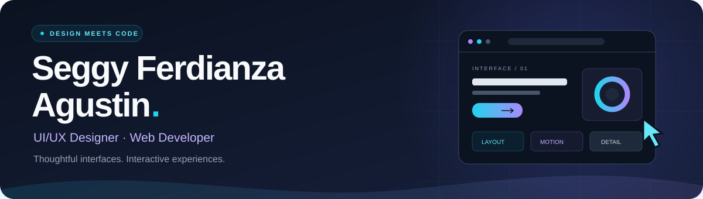

  

<!--  -->

<h2>About me</h2>

Hi, I'm <strong>Seggy Ferdianza Agustin</strong>, a <strong>UI/UX Designer &amp; Web Developer</strong>. I bring interface ideas into interactive web experiences, with a focus on clear layouts, responsive behavior, and the details that make a website feel considered.

<ul>
<li><strong>Design &amp; development:</strong> web interfaces, interactive prototypes, and frontend implementation.</li>
<li><strong>Project themes:</strong> hospitality experiences, storefronts, region exploration, and gesture-based interaction.</li>
<li><strong>Research:</strong> Information Systems prototypes involving Indonesian news data, CNN classification, and OCR.</li>
</ul>

<h2>Featured projects</h2>

A selection of interfaces and interactions I've built, starting with two hospitality projects.

<table>
<tr><td width="50%" valign="top">
<h3><a href="https://github.com/EGYYFZA/Revamp-royal-purnama-public">01 / Royal Purnama</a></h3>

A hospitality website concept with villa exploration, filters, dining and wellness pages, and browser-only enquiry drafts.

<code>React · JavaScript · CSS</code>

<a href="https://github.com/EGYYFZA/Revamp-royal-purnama-public"><strong>Explore the source ↗</strong></a>

Portfolio edition with external media and system fonts; not the official hotel booking service.

</td>
<td width="50%" valign="top">
<h3><a href="https://github.com/EGYYFZA/Room-Explorer">02 / Sela House · Room Explorer</a></h3>

A fictional hotel experience with horizontal navigation, room filters, galleries, page transitions, and a simulated stay planner.

<code>Next.js · React · CSS</code>

<a href="https://github.com/EGYYFZA/Room-Explorer"><strong>Explore the source ↗</strong></a>

A frontend prototype; booking and payment processing are not connected.

</td></tr>
<tr><td width="50%" valign="top">
<h3><a href="https://github.com/EGYYFZA/frontend-assesment-kledo">03 / Indonesia Region Explorer</a></h3>

A responsive region explorer with dependent location filters and URL-based state.

<code>React · TypeScript · Tailwind CSS</code>

<a href="https://github.com/EGYYFZA/frontend-assesment-kledo"><strong>Explore the source ↗</strong></a>

<a href="https://frontend-assesment-kledo.vercel.app/">Try the live demo ↗</a>

</td>
<td width="50%" valign="top">
<h3><a href="https://github.com/EGYYFZA/magna-care">04 / Magna Care</a></h3>

A skincare storefront demo exploring product discovery, catalog presentation, and shopping cart interactions.

<code>React · Tailwind CSS · Vite</code>

<a href="https://github.com/EGYYFZA/magna-care"><strong>Explore the source ↗</strong></a>

</td></tr>
</table>

<h3>More to explore</h3>
<table>
<thead><tr><th align="left">Project</th><th align="left">Focus</th><th align="left">Tools</th></tr></thead>
<tbody>
<tr><td><a href="https://github.com/EGYYFZA/hand-touch-design"><strong>GestureCanvas</strong></a></td><td>A camera-based canvas controlled through hand gestures.</td><td>Python · OpenCV · MediaPipe</td></tr>
<tr><td><a href="https://github.com/EGYYFZA/multimodal-cnn-ocr"><strong>HoaxShield</strong></a></td><td>A thesis prototype combining CNN classification and OCR.</td><td>Python · FastAPI · TensorFlow</td></tr>
<tr><td><a href="https://github.com/EGYYFZA/ecommerce-datahub"><strong>DataHub</strong></a></td><td>A local demo of internet packages, customer profiles, and simulated orders.</td><td>React · TypeScript · Express</td></tr>
<tr><td><a href="https://github.com/EGYYFZA/bus-ticket-booking"><strong>Buseet</strong></a></td><td>A static prototype of the bus ticket booking journey.</td><td>HTML · CSS · JavaScript</td></tr>
</tbody>
</table>

<h2>Technology &amp; tools</h2>

Tools used across these projects.

<strong>Frontend</strong>

<strong>Research &amp; delivery</strong>

  
  
  
  
  
  
  

<h2>GitHub activity</h2>

<a href="https://github.com/EGYYFZA?tab=overview">View my contribution calendar on GitHub ↗</a>

<h2>Research &amp; data</h2>

<a href="https://github.com/EGYYFZA/scrape-kompas">Kompas News Collector</a> and <a href="https://github.com/EGYYFZA/scrape-turnbackhoax">TurnBackHoax Collector</a> support my exploration of Indonesian news datasets.

<h3>Let's build something thoughtful.</h3>

<a href="https://www.linkedin.com/in/seggy-ferdianza-agustin-278ab9241/"><strong>Connect on LinkedIn ↗</strong></a> · <a href="https://github.com/EGYYFZA?tab=repositories">Browse all projects</a>

Project READMEs describe setup and prototype limitations. Technology badges describe project tools, not certifications. Activity cards use public GitHub data and may be cached or temporarily unavailable.

